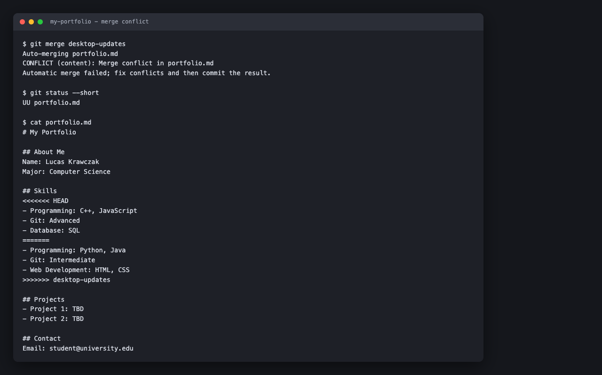
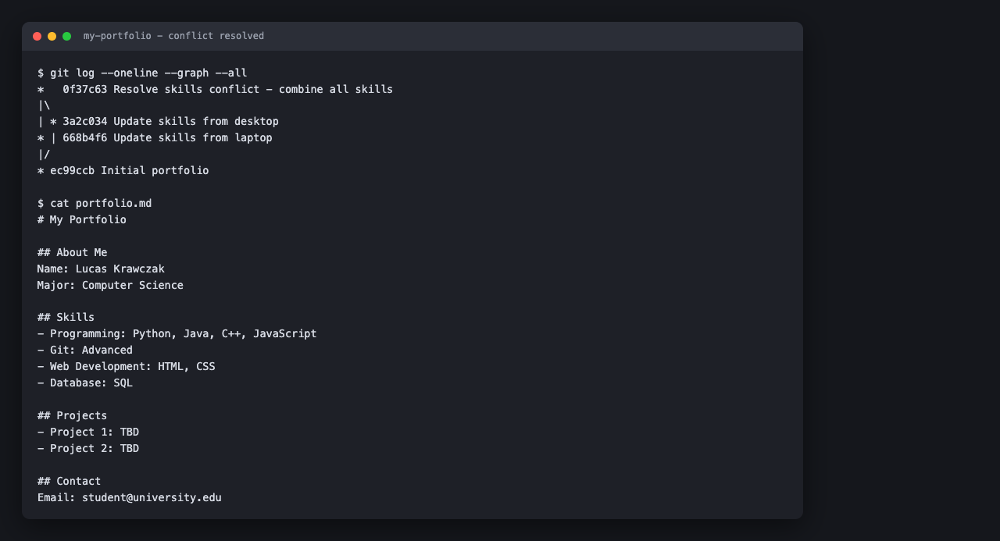
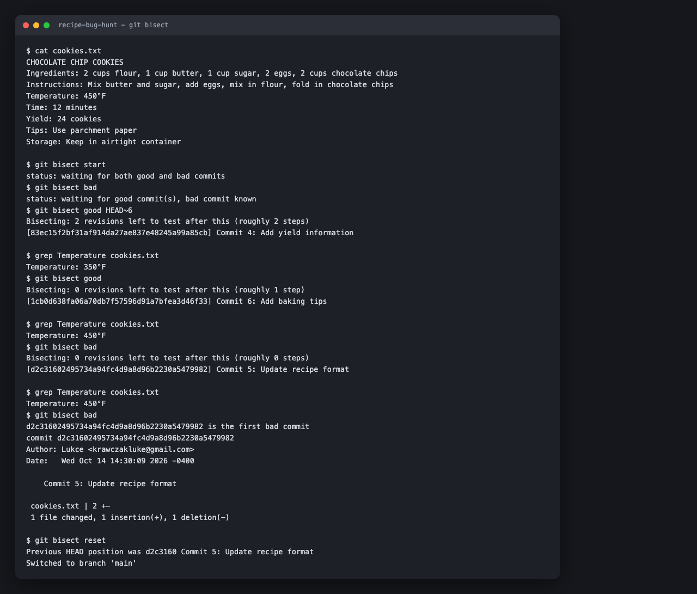
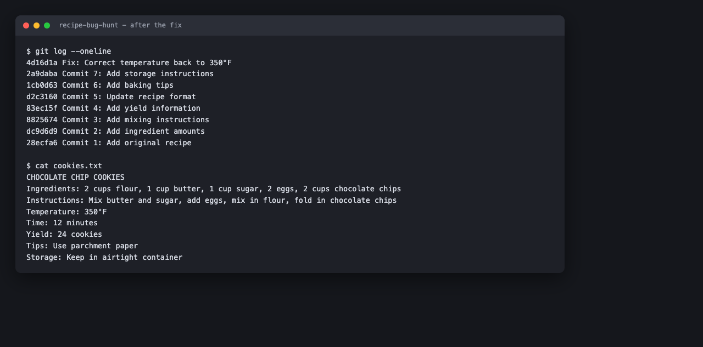

# Lab 7: Git Exercises — Merge Conflicts and Bisect

Student: Lucas Krawczak
Completed: 2026-10-14
Solo lab (no team requirement).

Supporting files in this folder: `portfolio.md` (final resolved file, Exercise 1),
`cookies.txt` (final fixed recipe, Exercise 2), and `screenshots/`.

---

## Exercise 1: Personal Portfolio Conflict Simulation

### The conflict as Git reported it



```
$ git merge desktop-updates
Auto-merging portfolio.md
CONFLICT (content): Merge conflict in portfolio.md
Automatic merge failed; fix conflicts and then commit the result.
```

Conflict markers in `portfolio.md`:

```markdown
## Skills
<<<<<<< HEAD
- Programming: C++, JavaScript
- Git: Advanced
- Database: SQL
=======
- Programming: Python, Java
- Git: Intermediate
- Web Development: HTML, CSS
>>>>>>> desktop-updates
```

### Resolution

Combined both sides, removed all markers, then `git add portfolio.md` and committed.
Final Skills section:

```markdown
## Skills
- Programming: Python, Java, C++, JavaScript
- Git: Advanced
- Web Development: HTML, CSS
- Database: SQL
```

### Verification — `git log --oneline --graph --all`



```
*   0f37c63 Resolve skills conflict - combine all skills
|\
| * 3a2c034 Update skills from desktop
* | 668b4f6 Update skills from laptop
|/
* ec99ccb Initial portfolio
```

The merge commit has two parents, one from each branch. That diamond is the proof
two separate lines of work got rejoined.

### Reflection questions

**1. Why did the conflict occur? What lines were changed in both branches?**

Both branches rewrote the same three lines — the contents of the `## Skills` section.
Desktop made them Python/Java, Intermediate, Web Development. Main made them
C++/JavaScript, Advanced, Database. Same lines, two different answers.

Git merges changes to different parts of a file without blinking. The About Me,
Projects and Contact sections all merged silently here. It only stops when two
branches edit the same region relative to where they split, because at that point
there is no rule it can follow. Picking a winner would mean understanding what the
text means, and Git does not.

So it does the honest thing. It stops and hands me the decision.

**2. What would have prevented this conflict?**

Not editing the same lines in two places at the same time.

Concretely: finish the desktop work and merge it before starting on the laptop. Or
split the file so each device owns a different section.

This was never a Git problem. It was a sequencing problem that showed up as a Git
problem.

**3. In real life, how do you avoid conflicts when working on multiple devices?**

Four habits, in order of how much they actually help:

- `git pull` before you start, not after you're done. Most of my conflicts have come
  from starting work on a stale base.
- `git push` the moment a chunk is coherent, so the other machine can see it.
- Commit small. Small commits produce small conflicts you can read in one screen.
- Treat the remote as the source of truth. Never let a device sit for days holding
  commits nobody else has.

The pattern underneath all four: conflicts scale with how long two copies drift
apart. Shorten the drift and the problem mostly stops existing.

**4. What was the most challenging part of resolving the conflict?**

Deciding what the merged version should actually say. Git cannot help with that part.

Deleting the markers is mechanical. Knowing that "Git: Advanced" should beat
"Git: Intermediate" rather than both lines surviving is a judgment call about what
the content means. The tool got me to the decision and then got out of the way.

**5. How did Git help you identify where the conflict was?**

It named the file, wrote the markers straight into it so the exact region was visible
in my editor, and labelled both sides — `HEAD` for where I was, `desktop-updates` for
what was coming in. `git status` kept the file under "Unmerged paths" until I staged it.

It never tried to guess. It just showed me precisely what it could not decide.

---

## Exercise 2: Recipe Bug Hunt with Git Bisect

### Bisect session (actual output)



```
$ git bisect start
$ git bisect bad
$ git bisect good HEAD~6
Bisecting: 2 revisions left to test after this (roughly 2 steps)
[83ec15f] Commit 4: Add yield information

$ grep Temperature cookies.txt        # 350°F -> good
$ git bisect good
Bisecting: 0 revisions left to test after this (roughly 1 step)
[1cb0d63] Commit 6: Add baking tips

$ grep Temperature cookies.txt        # 450°F -> bad
$ git bisect bad
Bisecting: 0 revisions left to test after this (roughly 0 steps)
[d2c3160] Commit 5: Update recipe format

$ grep Temperature cookies.txt        # 450°F -> bad
$ git bisect bad
d2c31602495734a94fc4d9a8d96b2230a5479982 is the first bad commit
commit d2c31602495734a94fc4d9a8d96b2230a5479982
Author: Lukce <krawczakluke@gmail.com>
Date:   Wed Oct 14 14:30:09 2026 -0400

    Commit 5: Update recipe format

 cookies.txt | 2 +-
 1 file changed, 1 insertion(+), 1 deletion(-)
```

Worth noticing: the commit message says "Update recipe format." It says nothing about
temperature. Reading the log would never have found this. That is the whole reason
bisect exists.

### `git log --oneline` after the fix



```
4d16d1a Fix: Correct temperature back to 350°F
2a9daba Commit 7: Add storage instructions
1cb0d63 Commit 6: Add baking tips
d2c3160 Commit 5: Update recipe format
83ec15f Commit 4: Add yield information
8825674 Commit 3: Add mixing instructions
dc9d6d9 Commit 2: Add ingredient amounts
28ecfa6 Commit 1: Add original recipe
```

### Reflection questions

**1. How many times did you have to check the temperature before Git found the bug?**

Three. Commit 4 came back good, commit 6 bad, commit 5 bad, and that was it.

Seven commits, three checks. Matches the diagram in the lab exactly.

**2. If you had 100 commits instead of 7, about how many checks would bisect need?**

About 7. Bisect throws away half the remaining range every answer, so the cost is
log₂(n), not n. A thousand commits is about 10 checks.

That's the part that surprised me. Going from 100 commits to 1000 — ten times the
history — costs three more checks. The search barely notices how big the repo got.

**3. How is bisect different from manually checking each commit with `git checkout`?**

Checking by hand is linear. Worst case I inspect all N commits, and I'm also tracking
in my head which ones I already ruled out.

Bisect is binary search with the bookkeeping handled. It picks the midpoint, uses my
answer to discard half the range, and remembers the window for me.

Three checks instead of up to seven here. On a real repo with 2,000 commits since the
last good release, it's about 11 checks instead of potentially 2,000. That's not a
nicer workflow, that's the difference between doing it and not bothering.

**4. When would git bisect be most useful in real projects?**

When I can reproduce a bug but have no idea what caused it, and there's a lot of
history between the last version that worked and now. "This passed in last month's
release and fails today" across a few hundred commits is exactly the shape.

It gets better if the check can be scripted. `git bisect run <script>` finds the
commit with zero input from me — I describe what "broken" means once, and it does
every check itself.

**5. What information do you need to start a bisect session?**

One commit you know is bad, usually `HEAD`. One commit you know is good, somewhere
earlier.

And the thing the lab doesn't say out loud: a test you actually trust. Here it was
reading one line. If that test is flaky, bisect still finishes and still gives you an
answer with total confidence, and the answer is wrong. The search is only as good as
the question you're answering at each step.

---

## Submission checklist

### Exercise 1: Portfolio Conflicts
- [x] `git log --oneline --graph --all` output showing the merge (above)
- [x] Final `portfolio.md` with combined skills (above, and `portfolio.md` in this folder)
- [x] Answers to all 5 reflection questions

### Exercise 2: Recipe Bug Hunt
- [x] Bisect output showing which commit had the bug (commit 5, `d2c3160`)
- [x] `git log --oneline` after fixing the bug
- [x] Answers to all 5 reflection questions
- [ ] (Optional) Challenge: second bug hunt — not attempted

---
*Commands executed and write-up assisted with AI (Claude) per course policy on tool
use, same as Lab 2. Reflections are my own positions — review before submitting.*
